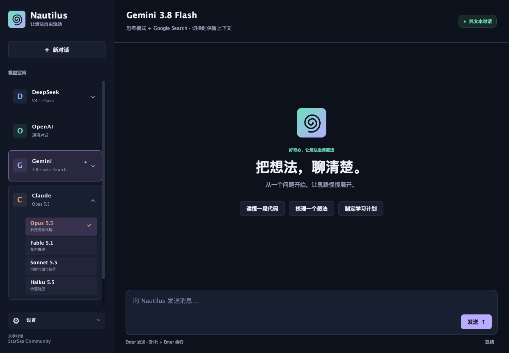
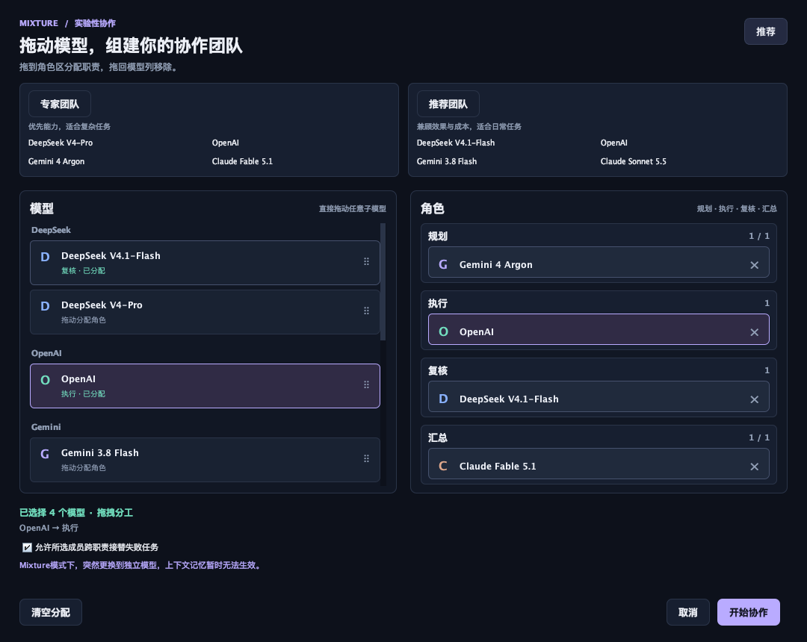

# Nautilus

**StarSea Community · Rust 后端与 Java 桌面端的多模型 AI 对话应用**

**Nautilus Alpha 0.0.2-alpha.2** · 当前版本 `0.0.2-alpha.2` · 文档更新于 **2026-10-19**

Nautilus 将 DeepSeek、OpenAI、Gemini 和 Claude 集成在同一个桌面界面中。使用自己的 API key 连续对话、切换模型，也可以通过 **Mixture 混合模式**组建模型团队，完成任务规划、子节点执行、独立复核和最终汇总。

当前为早期文本对话原型，需从源码构建。提供 Markdown 阅读、代码复制与修改、批注及相关上下文增强；自定义 Agent 工具执行仍处于原型阶段。

[GitHub 仓库](https://github.com/FrancisGray-Chou/Nautilus-Agent) · [更新内容](更新内容.md) · [版本记录](CHANGELOG.md) · [桌面指南](desktop/README.md) · [测试说明](docs/TESTING.md) · [隐私与密钥](desktop/PRIVACY.md) · [发布流程](docs/RELEASING.md)



*界面来自离线 Swing 渲染测试，使用模拟数据，不代表真实模型回答。*

## 功能概览

| 功能 | 当前行为 |
| --- | --- |
| 四平台对话 | 支持 DeepSeek、OpenAI、Gemini、Claude；独立模型之间切换保留当前对话历史 |
| 动态子模型菜单 | DeepSeek、Gemini、Claude 在侧栏内平滑展开；支持键盘导航、外部点击收起和选中反馈 |
| Mixture 协作 | 左列模型卡片，右列规划 / 执行 / 复核 / 汇总；拖放分工、替换、移除及排序 |
| 实时进度 | Rust 通过本机 SSE 推送调度事件，显示实际模型、职责、子节点、状态与耗时 |
| 联网搜索 | 四平台独立模型与桌面 Mixture 均支持搜索开关，展示返回的可核验来源 |
| Markdown | 支持标题、列表、引用、表格、代码、删除线及可点击链接 |
| 回复与代码操作 | 回复全文复制、代码单独复制、本地修改、行号批注及相关追问增强 |
| 动态聊天反馈 | 思考中、生成中、总结中气泡；复制成功确认、按钮悬停与点击反馈 |
| 设置与语言 | ⚙️ 设置集中管理密钥、语言及退出；支持简体中文、繁體中文、匈牙利语、英语 |
| 用户密钥 | 按本机系统账号保存，支持部分更新、按平台删除及全部删除 |
| CLI | 终端选择平台、连续输入任务及通过命令切换模型 |

点赞生成的追问建议、代码相关性判断及 Gemini Auto 路由均使用本地规则，不额外调用模型，也不自动发送建议。

## 快速开始

### 环境要求

- macOS 或 Linux；桌面端需要图形会话，窗口最低尺寸为 **1000 × 720**。
- Rust stable / Cargo，支持 Rust 2024 edition。
- 桌面端另需 **JDK 17+**，包含 `java` 与 `javac`。
- 至少一个平台的可用 API key，以及连接相应 API 的网络。

本地验证环境为 macOS Apple Silicon、Rust/Cargo 1.98.1、OpenJDK 25.0.1，Java 按 17 目标编译。JDK 17 运行时、Linux 及其他架构仍需独立验证；Windows 已初步实现桌面密钥存储所需的账户 ACL，由Linux/MacOS转译而来。首次 Cargo 构建可能联网下载依赖，Markdown JAR 已随源码提供。

### 启动桌面端

在包含 `Cargo.toml` 的工程根目录执行：

```bash
./desktop/run.sh
```

解压后若缺少执行权限，可使用 `bash desktop/run.sh`。该脚本构建 Rust bridge、编译 Java 并打开桌面窗口。

1. 在启动时显示的密钥窗口，或 **⚙️ 设置 → API 密钥与隐私**中，填写需要使用的平台 key。
2. 阅读明文存储说明，主动勾选确认后保存。无需配置全部四个平台。
3. 在侧栏选择独立模型，或打开 **Mixture混合模式**配置协作团队。
4. 输入问题，按 **Enter** 发送；使用 **Shift + Enter** 换行。

Claude 的密钥栏为 **Claude · Anthropic**，四个 Claude 子模型共用用户自己的 Anthropic API key。只配置 Claude 时，应用默认选择 Opus 5.5。

### 启动终端 CLI

CLI 使用工程 `.env` 或进程环境变量，与桌面端的密钥存储独立。配置示例见 `.env.example`。

```bash
# 已有 .env 时保留原文件。
[ -f .env ] || cp .env.example .env
# 用文本编辑器填写需要的平台 API key，然后启动：
cargo run --locked
```

| 输入位置 | 输入 | 作用 |
| --- | --- | --- |
| 服务菜单 | `1` / `2` / `3` / `4` | DeepSeek / OpenAI / Gemini / Claude |
| Gemini 子菜单 | `1` / `2` / `3` | Flash + Search / Argon + Search / Auto |
| 普通对话 | 任意文本，包括数字 | 作为用户问题发送 |
| 任意阶段 | `/model` | 返回服务选择菜单 |
| 任意阶段 | `/exit`、`/quit` 或 EOF | 退出 |

CLI 选择 Claude 后默认使用 Opus 5.5，可通过 `CLAUDE_MODEL` 指定其他模型。CLI 当前没有 Claude 二级选择菜单、Mixture 组队窗口及 Markdown 操作按钮；需要清空 CLI 历史时重启进程。

## 模型与配置

以下名称及 API ID 对应当前代码中的预设，不构成真实 API 可用性的验证。模型访问权限、区域、额度和费用由平台及用户账号决定。

| 平台 | 桌面预设 | 实际 API 模型 ID | 密钥变量 |
| --- | --- | --- | --- |
| DeepSeek | V4.1-Flash | `deepseek-flash` | `DEEPSEEK_API_KEY` |
| DeepSeek | V4-Pro | `deepseek-v4-pro` | `DEEPSEEK_API_KEY` |
| OpenAI | OpenAI | 默认 `gpt-5-mini` | `OPENAI_API_KEY` |
| Gemini | 3.8 Flash | `gemini-3.8-flash` | `GEMINI_API_KEY` |
| Gemini | 4 Argon | `gemini-4-argon` | `GEMINI_API_KEY` |
| Gemini | Auto | 按本轮任务在 Flash / Argon 间选择 | `GEMINI_API_KEY` |
| Claude | Opus 5.5 | `claude-opus-5-5` | `ANTHROPIC_API_KEY` |
| Claude | Fable 5.1 | `claude-fable-5-1` | `ANTHROPIC_API_KEY` |
| Claude | Sonnet 5.5 | `claude-sonnet-5-5` | `ANTHROPIC_API_KEY` |
| Claude | Haiku 5.5 | `claude-haiku-5-5` | `ANTHROPIC_API_KEY` |

### 预设与环境变量

- **桌面端密钥**仅来自用户在设置中保存的配置，不读取工程 `.env`，也不回退使用继承的 API key。
- 桌面 DeepSeek 两个预设、Gemini 三个分支及 Claude 四个预设明确指定模型。OpenAI 默认使用 `gpt-5-mini`，可通过启动进程的 `OPENAI_MODEL` 环境变量覆盖。
- CLI 环境变量优先于工程 `.env`。DeepSeek、OpenAI、Claude 分别读取 `DEEPSEEK_MODEL`、`OPENAI_MODEL`、`CLAUDE_MODEL`；默认值见 `.env.example`。
- CLI 的 Gemini 子菜单固定模型预设，搜索遵循 `GEMINI_WEB_SEARCH`（未设置时默认开启）；库接口 `with_provider(ModelProvider::Gemini)` 同时读取 `GEMINI_MODEL`。搜索设为 `false` 时使用纯对话兼容接口。桌面输入框的“联网搜索”气泡可覆盖本次运行的搜索状态，默认读取环境变量或工程 `.env` 的非密钥搜索选项。
- Gemini Auto 根据复杂任务关键词、代码围栏或至少 1200 字符的输入选择 Argon，否则选择 Flash。“继续”“继续处理”“continue”“go on”沿用上一轮模型；附带的代码上下文也可能影响路由。

### Claude 原生协议

Claude 使用 Anthropic 原生 `POST https://api.anthropic.com/v1/messages`，通过 `x-api-key` 和 `anthropic-version: 2023-06-01` 发送请求。保留用户及助手历史，只展示响应中的文本块，排除思考块。

每次 Claude 请求设置 `max_tokens=16384`。独立对话遇到不完整输出会附加提示；Mixture 按 `stop_reason` 判断阶段是否完整结束，未完整结束的汇总可交由其余已选模型接续。该输出上限不属于预算保护。

模型正式名称使用 **Fable 5.1**。模型映射维护在 `src/config.rs`，原生适配位于 `src/llm/claude.rs`。

桌面“联网搜索”同时开放给 DeepSeek Flash / Pro、OpenAI、Gemini 和 Claude，以及所有 Mixture 团队。DeepSeek 使用工具调用 Search API；OpenAI 使用 Responses `web_search`；Claude 使用原生 Web Search；Gemini 使用 Google Search。各平台仅使用自己的用户 key，保留当前选定模型；兼容旧配置名 `GEMINI_WEB_SEARCH` 作为整个桌面的默认开关。搜索权限、模型支持与工具费用由各平台账号决定，失败时显示错误，不静默改为离线回答。

搜索协议：[DeepSeek Search API](https://api-docs.deepseek.com/zh-cn/api/search/)、[OpenAI Web Search](https://developers.openai.com/api/docs/guides/tools-web-search)、[Claude Web Search](https://platform.claude.com/docs/en/agents-and-tools/tool-use/web-search-tool)。

接口参考：[DeepSeek](https://api-docs.deepseek.com/)、[OpenAI](https://platform.openai.com/docs/models)、[Gemini](https://ai.google.dev/gemini-api/docs/models)、[Google Search](https://ai.google.dev/gemini-api/docs/google-search)、[Claude 模型目录](https://platform.claude.com/docs/en/models/overview)、[Anthropic Messages API](https://platform.claude.com/docs/en/api/messages/create)。

## Mixture 混合模式

点击侧栏 **Mixture混合模式**打开两列面板：左列为模型，右列为 **规划、执行、复核、汇总** 四个角色区。首次打开时角色区为空，按需拖入模型即可组队，无需下拉选择或填写角色名称、具体目标和顺序数字。

左侧直接列出十个子模型卡片，按 DeepSeek、OpenAI、Gemini、Claude 分组。未配置 API key 的卡片灰显，不可拖入；模型列可滚动查看全部版本。

点击右上角 **推荐**，在面板内展开 **专家团队** 和 **推荐团队** 两张预设卡片，不使用下拉菜单。专家团队优先使用当前已接入的高能力子模型；推荐团队兼顾成本和任务效果。

| 平台 | 专家团队 | 推荐团队 |
| --- | --- | --- |
| DeepSeek | V4-Pro | V4.1-Flash |
| OpenAI | 当前配置的 OpenAI 模型 | 当前配置的 OpenAI 模型 |
| Gemini | 4 Argon | 3.8 Flash |
| Claude | Fable 5.1 | Sonnet 5.5 |

OpenAI 当前只提供一个入口，默认 `gpt-5-mini`，可由进程环境 `OPENAI_MODEL` 配置；两套团队均沿用该入口，不宣称它是 OpenAI 全系列最强模型。上述建议根据截至 2026-10-19 的[DeepSeek 模型与价格](https://api-docs.deepseek.com/quick_start/pricing/)、[Gemini 模型与价格](https://ai.google.dev/gemini-api/docs/pricing)及[Claude 模型目录](https://platform.claude.com/docs/en/models/overview)整理，是固定的能力/成本取向预设，不实时比较价格，也不保证每个任务的最优成本。Sonnet 用于平衡综合交付质量与成本；如更重视低成本，可继续拖换为 Haiku。

预设只加入已配置 key 的平台，每个平台一个子模型。四平台齐全时依次分配规划、执行、复核、汇总；缺少平台时保留可用成员，将最后一个设为汇总，其余按顺序分配规划、执行。只有一个平台时直接负责汇总；没有 key 时两套预设均不可应用。点击预设只替换当前草稿，保留用户的跨职责接替选择，可以继续拖拽调整；确认前不会调用模型，取消不改变原团队。


| 操作 | 结果 |
| --- | --- |
| 模型卡片拖到角色区 | 将该模型分配给对应职责 |
| 已分配卡片拖到其他角色 | 更换职责 |
| 在同一角色区拖动卡片 | 按落点调整执行顺序 |
| 拖回左列 / 点击 × / Delete | 移除该模型的分工 |
| 拖入同平台另一子模型 | 替换该平台当前版本，保持每个平台一个子模型 |
| 拖入已占用的规划或汇总区 | 新卡片替换旧卡片，旧卡片恢复未分配状态 |
| 推荐 → 专家团队 / 推荐团队 | 按已配置平台填入可编辑的团队草稿 |
| 清空分配 | 清空当前草稿的全部角色区 |
| 开始协作 | 将完整模型、角色和顺序配置提交给 Rust |

规划最多一个且可留空，汇总必须且只能有一个；执行和复核可放多个不同平台的模型。角色与平台不绑定，例如可以让 **Claude 规划、OpenAI 执行、Gemini 复核、DeepSeek 汇总**。也可以只拖入一个汇总模型直接交付。

拖动时显示卡片预览、目标区高亮和插入位置，放下后给出短暂反馈。也支持先点击模型再点击角色标题，或使用数字键 **1 / 2 / 3 / 4**分配至规划 / 执行 / 复核 / 汇总。

取消窗口或取消拖动不提交配置；重新打开恢复本次进程内已确认的模型、角色、顺序及接替选项。历史表单中的角色名称与目标不再出现在面板中，桌面端按所选角色生成工作指令。退出后不持久保存团队配置。

后端按已分配角色依次运行 **规划 → 执行 → 复核 → 汇总**，同阶段采用卡片顺序。跨职责失败接替默认关闭，可由用户主动勾选开启。

规划成员可从真实响应中生成 **1 至 6 个结构化子节点**，参考各执行成员的目标，通过 `assignee` 指定执行成员；未指定时按已配置执行成员的顺序轮换。没有有效计划、没有规划成员，或执行成员未分到节点时，执行成员直接完成自己的目标；之后由复核成员依次检查，最终由指定的汇总成员交付。前序成果传给后续成员参考，当前仍按阶段接力，不并发请求所有模型。

失败节点可交给其余可用执行成员；跨阶段接替仅在用户主动开启时使用，并显示接替提示。汇总成员失败且未开启跨职责接替时，保留中间结果并标记未完成，不暗中改由其他职责交付。失败成员在当前会话停用，新建对话或重新确认团队可重试。未选平台不会被调用，全部调用失败时报告失败。



*离线交互测试预览，模型与角色分配为测试输入。*

混合会话与独立模型会话分开保留。调整团队继承混合历史，新建混合对话清空混合历史；修改或删除密钥会清空两类会话。弹窗固定提示：

> Mixture模式下，突然更换到独立模型，上下文记忆暂时无法生效。

**本测试版暂不启用预算保护。** 不读取 `MIXTURE_*` 价格或预算配置，不按余额限制输出；平台限流、超时和输出上限仍然适用。`src/budget.rs` 保留供后续版本使用。桌面混合调用可通过“联网搜索”气泡为各成员启用所属平台的搜索；CLI 混合调用默认关闭搜索，均不执行用户自定义工具，生成的代码及文稿在对话中呈现。

## 桌面交互

### 设置与子模型菜单

**⚙️ 设置**集中提供 API 密钥与隐私、语言及退出。支持简体中文、繁體中文、匈牙利语和英语；语言偏好在本机记忆，聊天内容、代码、批注及草稿保留原样。模型菜单支持方向键、Enter、Escape 和外部点击收起，请求期间禁用模型切换，切换失败保留已确认的选择。

侧栏、密钥表单与 Mixture 成员区支持纵向滚动。菜单展开后跟随视口宽度布局，避免滚动条遮挡卡片右边缘；协作分工说明支持换行。按钮提供悬停渐变、点击及焦点反馈，复制成功短暂显示“已复制 ✓”。设置齿轮改用居中的矢量图形，避免字体偏心；菜单、推荐区和弹窗共用 220ms 展开缓动，全部动画使用 16ms 帧间隔，悬停共用时间驱动渐变。快速反向从当前进度衔接，悬停不触发菜单重新排版，组件移除后清理计时器与残留状态；运行中的进度重新显示时恢复，完成后保持静止。

### Markdown、代码与追问

回复可一键复制原始 Markdown。代码块可单独复制当前版本、修改并保存本地草稿、添加批注或引用选中的代码行。代码块具有当前会话内的编号，例如 `C1`；后续问题与代码高度相关或显式引用编号时，可附带当前代码及批注。输入区显示引用提示，并可取消本轮附带。

代码修改保留原始回复，不会自动写入项目文件或执行代码。点赞使用本地规则生成可编辑的后续问题建议，用户确认发送后才调用模型。

### SSE 与动态进度

桌面默认启动 Rust `--sse` 模式，通过本机 `POST /command` 消费 `text/event-stream`。Rust 仅监听 `127.0.0.1` 随机端口，使用每次启动生成的会话凭证，并发送心跳；保留 JSON Lines v2 兼容入口。

阶段记录包括 Planner / Worker / Reviewer / Summarizer、用户自定义角色名、实际模型、状态、耗时及可选节点数。聊天气泡按真实阶段显示“思考中💭”“生成中”“复核中”“总结中”；完成、失败或退出时停止计时，阅读较早消息时不强制滚回底部。

**SSE 当前传输调度进度，模型正文仍在完整返回后一次渲染。** 节点数来自有效计划，界面不展示模型内部思维过程，也不提供虚构的进度百分比。

## 密钥与会话数据

桌面 key 以明文保存在当前操作系统用户的私有配置中，输入框遮蔽显示。保存前需主动确认明文存储说明，留空保留原密钥，支持按平台替换或删除；删除全部 key 会移除该配置文件。

| 环境 | 默认位置 |
| --- | --- |
| macOS | `~/Library/Application Support/Nautilus/.env` |
| Linux | `$XDG_CONFIG_HOME/Nautilus/.env`；未设置时为 `~/.config/Nautilus/.env` |
| Windows | `%APPDATA%\Nautilus\.env`；回退至用户目录的 `AppData\Roaming\Nautilus\.env` |
| 开发与测试 | `NAUTILUS_PROFILE_DIR` 可指定隔离目录 |

macOS/Linux 使用目录权限 `0700`、文件权限 `0600`；Windows 使用账户专属的受保护 ACL。应用没有新增云端账号，系统账号下的其他程序或管理员仍可能读取明文。聊天、草稿、代码修改与批注保存在本机历史文件中，重启后可从“历史对话”恢复；点赞状态仅保留在内存。

独立模型之间切换会将已有历史发送给新平台；Mixture 将问题、混合历史及前序工作记录交给已选平台。删除本地 key 不会撤销平台密钥或删除平台已处理的数据。完整说明见[隐私与密钥](desktop/PRIVACY.md)。

## 开发与验证

在工程根目录运行：

```bash
cargo fmt --check
cargo test --locked
cargo clippy --locked --all-targets -- -D warnings
./desktop/test.sh
python3 scripts/check_release.py
python3 scripts/test_release.py
```

本机端口受限时，可显式使用管道完成 Java↔Rust 集成检查：

```bash
NAUTILUS_TEST_TRANSPORT=stdio ./desktop/test.sh
```

最近验证记录：后端为 2026-10-18，团队推荐、统一动画和拖拽面板为 2026-10-19。

| 检查 | 已记录结果 |
| --- | --- |
| Rust | 51 项测试通过：库 47、CLI 4；格式检查与 Clippy 通过 |
| Java 桌面与管道集成 | 严格 Java 17 目标编译通过，9 组检查通过 |
| SSE 离线检查 | 分包、Unicode、心跳、不完整 EOF、阶段跟踪及计时通过 |
| 发布回归 | 7 项检查通过 |
| 完整 SSE 端口联调 | 当前执行环境拒绝绑定本机端口，未完成 |
| 四平台真实付费 API | 尚未执行 |

上述为当前功能快照的既有验证记录。仅更新文档时不重新触发付费 API 请求；本轮文档检查结果见[更新内容](更新内容.md)。管道集成或离线 SSE 解析通过不等于真实 SSE socket 联调通过。GitHub CI 与其他运行环境的结果需另行确认，详见[测试说明](docs/TESTING.md)。

Windows 的账户配置、原生 ACL 和安装器构建入口见 [Windows 指南](desktop/WINDOWS.md)。GitHub Actions 会在推送至 `main`／`master`、推送 `v*` 标签或提交 Pull Request 时自动构建 MSI，并上传安装器及 SHA-256，也支持手动触发。`scripts/package_windows.py` 在 Windows 默认生成 MSI，可用 `--installer-type exe` 生成 EXE；其他系统用 `--prepare-only` 导出明确标注的源码构建包。构建中间目录和安装包输出均位于工程之外。

## 当前限制

- 尚无上游逐 Token 正文输出、停止生成按钮或自动上下文裁剪。
- 不支持文件、图片、音视频输入；自定义工具执行未完整接入。
- Mixture 使用阶段接力协作，暂不启用预算保护；桌面各平台成员均支持联网搜索。
- 本地追问建议与代码相关性判断可能误判，显式引用 `C1` 等编号更明确。
- 桌面失败请求不提交该轮模型历史；CLI 失败请求仍可能保留用户输入。
- 尚无安装器、签名应用和自动更新，模型可用性仍需使用测试者自己的 key 验证。

## 工程与文档

| 路径 | 内容 |
| --- | --- |
| `src/main.rs` | CLI 菜单及连续对话 |
| `src/config.rs` | 平台配置、模型映射及 Gemini Auto 路由 |
| `src/llm.rs`、`src/llm/` | 通用请求、四平台联网搜索与 Claude 原生协议 |
| `src/agent.rs`、`src/message.rs`、`src/logbook.rs` | 会话、消息及历史 |
| `src/mixture.rs`、`src/progress.rs` | 协作调度及阶段事件 |
| `src/bridge.rs`、`src/sse.rs`、`src/bin/nautilus-chat-bridge.rs` | 桌面桥接、HTTP SSE 及管道入口 |
| `src/credentials.rs` | 本机用户密钥存取及删除 |
| `desktop/src/main/java/`、`desktop/src/test/java/` | Swing 界面与离线检查 |
| [桌面依赖](desktop/lib/README.md) | CommonMark JAR、哈希与第三方许可 |
| [更新内容](更新内容.md)、[版本记录](CHANGELOG.md) | 当前开发更新及历史版本 |
| [测试说明](docs/TESTING.md)、[发布流程](docs/RELEASING.md) | 验证边界与源码打包 |
| [Alpha 发布说明](docs/releases/v0.0.2-alpha.2.md) | 当前 Alpha 预发布说明 |

发布准备可运行 `python3 scripts/package_release.py`，需要 Python 3.11+。文档更新不自动提交代码、创建标签或发布 GitHub Release。问题反馈请提供版本、系统、复现步骤和脱敏错误，不要附带 API key、`.env` 或私人对话。

## 许可证

仓库当前未指定项目级 `LICENSE`。随附 CommonMark 依赖的 BSD 2-Clause 许可独立保留，详见[依赖说明](desktop/lib/README.md)。


发布至 GitHub：在已登录 GitHub CLI 且可正常联网的本机终端运行 `python3 scripts/publish_github.py --publish`。脚本保留远端历史，上传完整源码，等待 CI 后创建新标签和 Pre-release；不会覆盖已有版本。不带参数仅执行离线预览，详见[发布流程](docs/RELEASING.md)。

### 侧栏与本地历史

桌面侧栏支持拖动调宽、模型图标模式，以及默认展开的“模型空间”和默认折叠的“历史对话”。聊天记录自动保存，历史条目标明已使用的平台类别与具体子模型，点击即可恢复对话、草稿和代码批注并继续聊天。详见[桌面端说明](desktop/README.md#可拉伸侧栏与历史对话)。
