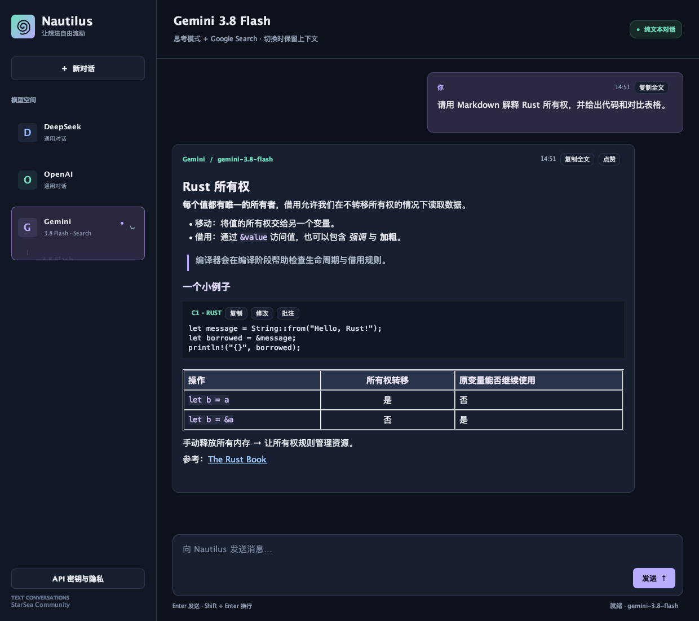

# Nautilus

**StarSea Community · Rust 后端 + Java 桌面端的多模型文本对话原型**

**Alpha 0.0.1** · 版本 `0.0.1-alpha.2` · 预发布标签 `v0.0.1-alpha.2`

Nautilus 将 DeepSeek、OpenAI 和 Gemini 放进同一个聊天界面。你可以连续对话、切换模型、阅读 Markdown，直接修改回复中的代码并添加批注，再把相关内容带入下一轮问题。

本版本面向早期测试，提供源码包，需要本机构建；尚未提供安装器、签名应用或自动更新。当前实现以 **LLM 文本对话** 为中心，自定义 Agent 工具执行仍是原型接口。

[GitHub 仓库](https://github.com/FrancisGray-Chou/Nautilus-Agent) · [桌面使用指南](desktop/README.md) · [版本记录](CHANGELOG.md) · [Alpha 发布说明](docs/releases/v0.0.1-alpha.2.md) · [测试说明](docs/TESTING.md) · [发布流程](docs/RELEASING.md) · [隐私与密钥](desktop/PRIVACY.md)



*界面截图来自本地离线测试，使用模拟对话，不代表真实模型回答。*

## 本版本能做什么

| 功能 | 行为 |
| --- | --- |
| 多平台对话 | 支持 DeepSeek、OpenAI、Gemini；切换模型保留当前历史 |
| Gemini 选择器 | 与侧栏统一的卡片，平滑展开 Flash、Argon、自动三个分支 |
| Gemini 搜索 | 原生 `generateContent` 接口接入 Google Search，显示返回的搜索词与来源 |
| Markdown 阅读 | 标题、列表、引用、表格、代码、删除线和可点击链接 |
| 回复操作 | 复制原始 Markdown；点赞生成可编辑的本地追问建议 |
| 代码工作流 | 代码块独立复制、修改、行号批注；相关追问附带当前版本，可取消 |
| 自备 API key | 桌面端按操作系统用户存储，支持替换、按平台删除和全部删除 |
| 终端模式 | 数字选择平台、连续输入任务，使用 `/model` 切换、`/exit` 或 `/quit` 退出 |

点赞建议和代码相关性判断使用本地规则，不是用户行为训练或额外的模型预测请求。Gemini 自动分支也使用本地规则，不额外调用路由模型。

## 快速开始

### 环境

- macOS 或 Linux，使用 Bash。桌面模式需要图形会话，窗口最低尺寸为 1000 × 720。
- Rust / Cargo：使用当前 stable 工具链，支持 Rust 2024 edition；本次本地验证为 Rust 1.98.1，尚未确定依赖整体的最低 Rust 版本。
- 桌面模式另需 **JDK 17+**（包含 `java` 和 `javac`）。本地使用 JDK 25.0.1、按 Java 17 目标编译；JDK 17 运行时验证交由 GitHub CI。
- 一个可用的平台 API key，以及连接对应 API 的网络。首次 Cargo 构建可能需要下载依赖。

本次本地验证平台为 macOS Apple Silicon。Linux 路径与 CI 已准备，尚未在本次本地环境验证；Windows 不属于本版本桌面密钥存储的支持范围。

### 桌面端

下载并解压源码包，进入包含 `Cargo.toml` 的目录：

```bash
./desktop/run.sh
```

如果解压工具未保留执行权限，可改用 `bash desktop/run.sh`。

启动后，在“API 密钥与隐私”中填写自己需要的平台 key，阅读明文存储说明并确认保存。无需同时配置三个平台。随后选择模型并发送消息。桌面端不读取工程根目录的 `.env`，也不会回退使用继承的开发者 API key。

详见[桌面使用指南](desktop/README.md)。

### 终端 CLI

CLI 使用工程 `.env` 或系统环境变量，与桌面端密钥存储独立。在工程根目录执行：

```bash
# 已有 .env 时不要覆盖；只补充需要的配置。
[ -f .env ] || cp .env.example .env
# 用文本编辑器填写需要的平台 API key。
cargo run --locked
```

| 输入位置 | 输入 | 作用 |
| --- | --- | --- |
| 服务菜单 | `1` / `2` / `3` | DeepSeek / OpenAI / Gemini |
| Gemini 菜单 | `1` / `2` / `3` | Flash + Search / Argon + Search / 自动 |
| 普通对话 | 任意文本，包括 `1`、`2`、`3` | 作为用户问题发送 |
| 任意阶段 | `/model` | 重新打开模型菜单 |
| 任意阶段 | `/exit`、`/quit` 或 EOF | 退出 |

CLI 每次回车提交一条输入。空输入忽略；请求失败后可以继续输入或切换模型。当前 CLI 不提供桌面端的 Markdown 操作按钮与新对话按钮；需要清空 CLI 历史时重启进程。

## 模型与配置

下表描述 **本版本代码中的默认值**。可用性、区域、额度和费用取决于所选平台及用户账号；离线检查不等于真实 API 认证测试。

| 选择 | 模型 ID / 规则 | 配置 |
| --- | --- | --- |
| DeepSeek | `deepseek-flash` | `DEEPSEEK_API_KEY`；可用 `DEEPSEEK_MODEL` 覆盖模型 |
| OpenAI | `gpt-5-mini` | `OPENAI_API_KEY`；可用 `OPENAI_MODEL` 覆盖模型 |
| Gemini Flash | `gemini-3.8-flash` | `GEMINI_API_KEY`；菜单固定预设 |
| Gemini Argon | `gemini-4-argon` | `GEMINI_API_KEY`；菜单固定预设 |
| Gemini 自动 | 在上述两个 Gemini 模型间选择 | 普通问题用 Flash；复杂关键词、代码围栏或至少 1200 字符用 Argon |

自动模式中的“继续”“继续处理”“continue”“go on”沿用上一轮模型。桌面端附带的代码上下文属于实际请求的一部分，也会影响自动分支判断。

- CLI 环境变量优先于 `.env`。桌面端的 API key 只来自用户配置；DeepSeek / OpenAI 的模型覆盖可通过启动进程的环境变量设置。
- 两个界面的 Gemini 菜单均固定模型预设并启用搜索，覆盖 `GEMINI_MODEL` 与 `GEMINI_WEB_SEARCH`。
- 库调用 `NautilusAgent::with_provider(ModelProvider::Gemini)` 才读取这两个 Gemini 变量；`GEMINI_WEB_SEARCH=false` 可改走兼容接口。普通用户无需修改它们。
- Gemini 原生预设请求高强度思考，仅展示最终回答。搜索是否实际执行由模型决定；没有来源数据时会明确提示。

接口参考：[DeepSeek](https://api-docs.deepseek.com/)、[OpenAI](https://platform.openai.com/docs/models)、[Gemini 模型](https://ai.google.dev/gemini-api/docs/models)、[Google Search](https://ai.google.dev/gemini-api/docs/google-search)。

## 数据与 Alpha 限制

桌面 API key 按用户要求以明文写入当前系统账号的私有 `.env`，不是加密密码库，也没有新增云端账号。当前会话保存在内存；切换平台会将历史交给新平台。新建对话、保存/删除密钥会清空桌面会话与本地批注。

- macOS：`~/Library/Application Support/Nautilus/.env`
- Linux：`$XDG_CONFIG_HOME/Nautilus/.env`，未设置时为 `~/.config/Nautilus/.env`

目录/文件权限为 `0700` / `0600`。这些控制不等于 GDPR 合规认证。完整的数据流、删除边界和部署责任见[隐私说明](desktop/PRIVACY.md)。

当前已知限制：

- 非流式输出，尚无停止生成按钮、聊天历史持久化或自动上下文裁剪。
- 不支持文件、图片、音视频输入，以及自定义工具执行。
- 代码相关性与追问建议可能误判；显式引用 `C1` 等编号更明确。
- 桌面失败轮次不提交到模型历史；CLI 的失败请求仍可能留下该条用户输入。
- 未执行真实付费 API 冒烟测试；各平台端到端调用及搜索质量仍需使用测试者自己的 key 验证。

## 工程导航

| 路径 | 内容 |
| --- | --- |
| `src/main.rs` | CLI 菜单和连续对话 |
| `src/agent.rs`、`src/llm.rs`、`src/llm/` | 会话与平台请求 |
| `src/bridge.rs`、`src/bin/nautilus-chat-bridge.rs` | 桌面 JSON Lines 协议 v2 |
| `src/credentials.rs` | 本机用户密钥保存与删除 |
| `desktop/src/main/java/` | Swing 界面、Markdown、代码批注与动画 |
| `desktop/src/test/java/` | 离线交互、渲染与 Java↔Rust 集成测试 |
| [desktop/lib](desktop/lib/README.md) | 随附 CommonMark JAR、校验值及授权 |
| `scripts/` | 发布检查、源码包构建与校验 |
| `.github/` | CI、手动预发布草稿工作流与反馈模板 |
| [docs](docs/RELEASING.md) | 测试、发布步骤与版本说明 |

## 开发与反馈

```bash
cargo fmt --check
cargo test --locked
cargo clippy --locked --all-targets -- -D warnings
./desktop/test.sh
```

发布准备另需 Python 3.11+，只使用标准库：

```bash
python3 scripts/check_release.py
python3 scripts/package_release.py
```

检查范围、真实 API 测试建议见[测试说明](docs/TESTING.md)。提交问题时请使用仓库的 Bug report 模板，附版本、系统、复现步骤和已脱敏的错误信息；不要附 API key、`.env` 或私人对话。

## 授权状态

仓库目前尚未包含项目级 `LICENSE`；本次发布准备没有替作者选择开源许可证。第三方 CommonMark 的 BSD 2-Clause 许可独立保留，详见[依赖说明](desktop/lib/README.md)。
