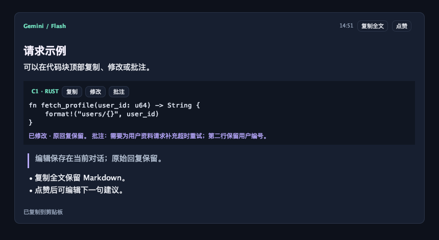

# Nautilus 桌面端

**Alpha 0.0.1 · `0.0.1-alpha.2`**

Java Swing 文本聊天客户端，通过本地 Rust 子进程调用 DeepSeek、OpenAI 和 Gemini。界面使用统一深色侧栏、连续消息卡片和可操作的 Markdown 代码块。

[返回项目首页](../README.md) · [隐私与密钥](PRIVACY.md) · [测试](../docs/TESTING.md) · [发布说明](../docs/releases/v0.0.1-alpha.2.md)

## 启动与首次配置

需要 macOS / Linux 图形桌面、Rust / Cargo、JDK 17+。首次 Rust 构建可能联网下载依赖；Markdown JAR 已随源码提供，不需要安装 Maven、JavaFX 或 IntelliJ。

在工程根目录运行：

```bash
./desktop/run.sh
```

启动脚本编译 Rust bridge 和 Java 源码，再打开窗口。若文件没有执行权限，使用 `bash desktop/run.sh`。源码包不是可直接双击运行的安装器。

每次启动会出现“API 密钥与隐私”：

1. 填写自己要使用的平台 API key，其他平台可留空。
2. 阅读并确认明文存储与第三方调用说明，点击保存。
3. 关闭设置窗口，在侧栏选择已配置的平台并开始对话。

已有密钥不会显示或预填。留空表示保留原值；删除请使用对应平台的删除按钮。设置也可随时从侧栏底部重新打开。

## 模型选择与聊天

| 操作 | 行为 |
| --- | --- |
| 点击 DeepSeek / OpenAI | 切换到对应平台，保留本轮会话历史 |
| 点击 Gemini 卡片 | 在侧栏内展开分支；约 220 ms 缓动，箭头旋转和悬停渐变 |
| 选择 Flash / Argon / 自动 | 切换预设并自动收起；卡片显示最近确认的分支 |
| 点击外部 / Esc | 收起 Gemini 分支，不发起模型请求 |
| 方向键 / Enter | 导航并确认 Gemini 选项；Space 也可操作按钮 |
| Enter / 发送 | 发送当前问题 |
| Shift + Enter | 输入换行 |
| 新对话 | 清空当前历史、点赞建议、代码修改和批注，保留当前模型 |

模型区域在空间不足时可滚动，底部 API 设置保持可见。请求在后台执行；等待期间可编辑下一条草稿，但发送、切换模型、新对话和密钥设置暂时禁用。

失败请求在聊天区显示错误，可以继续尝试；失败轮次不加入后端对话历史。模型切换只有在成功后才更新选中状态。API key 是否已配置不等于服务端已验证有效。

Gemini 的模型 ID、自动规则与搜索边界见[项目首页](../README.md)。本版本仍为完整回答后一次显示，没有流式输出和取消请求按钮。

## 阅读与复制 Markdown

支持标题、粗体、斜体、删除线、有序/无序及嵌套列表、引用、分隔线、代码、表格和 HTTP/HTTPS 链接。

- **复制全文**：复制模型原始 Markdown，包括原始代码块。
- **选择文本**：可局部选择并使用系统复制快捷键。
- **链接**：仅在主动点击时打开系统浏览器；图片仅显示替代文本。
- **代码排版**：保留缩进和换行，使用等宽字体；长行按消息宽度折行，不执行代码。
- **原始 HTML**：作为文字处理，不作为脚本或嵌入网页执行。

## 代码修改、批注与后续提问

每个围栏/缩进代码块有当前会话内的编号，例如 `C1`，顶部提供三个按钮：

| 按钮 | 用途 |
| --- | --- |
| 复制 | 复制当前本地代码版本，不包含 Markdown 围栏 |
| 修改 | 编辑代码和批注；保存后显示本地版本，原始模型回复仍保留 |
| 批注 | 选取代码、记录问题或修改意图；“引用所选代码行”会填入行号范围 |

在弹窗中取消不会保存草稿。清空批注可以删除它；“恢复原代码并清空批注”会取消该代码块的自动增强。批注中的行号是保存时的文本引用，后续改动代码不会自动重定位行号。

示例追问：`请根据 C1 的批注修改，并解释修改原因。`

- 显式提到代码编号时，会附带对应当前代码，即使还没有修改或批注。
- 对已经修改/批注的代码，本地规则会根据标识符、中文批注重合或“这段代码”等指代判断相关性。
- 输入区显示本次附带的编号；取消“附带”可仅发送当前输入。
- 最多附带最近的 3 个相关块；每块代码最多 12,000 个 Java 字符单位，代码合计最多 24,000，批注每块最多 2,000。截断会在界面及上下文中标明。
- 已在之前发送的内容仍属于后端历史。取消本轮附带或删除本地批注不会撤回旧请求；清空历史请使用“新对话”。



## 点赞与下一句建议

点赞会根据该回复是否包含代码，生成一条可编辑的后续问题建议。这是简单的本地规则，不是个性化预测模型，也不用于训练。

点击“填入建议”可放入输入区；已有草稿会保留，建议附加在后面。你可以修改后再发送。点赞、填入建议本身不调用平台 API，也不会自动发送消息。再次点击可取消点赞。

## 密钥、历史与账号

桌面端通过本地标准输入管道把 key 交给 Rust，保存到当前操作系统用户的配置目录：

| 平台 | 路径 |
| --- | --- |
| macOS | `~/Library/Application Support/Nautilus/.env` |
| Linux | `$XDG_CONFIG_HOME/Nautilus/.env`，默认 `~/.config/Nautilus/.env` |
| 开发/测试覆盖 | 设置 `NAUTILUS_PROFILE_DIR` 为独立目录 |

目录权限 `0700`、文件权限 `0600`；key 按要求明文保存，输入框遮蔽显示。这里的“账号”是系统账号，不是新增的云端账号。同一系统账号下的其他程序仍可能读到明文。

桌面端忽略工程 `.env` 和继承的 API key。保存或删除密钥会清空会话，避免沿用旧凭据；删除全部密钥会移除该用户配置文件。当前对话、点赞、代码编辑和批注只保存在进程内存，关闭后不自动恢复。

模型调用将问题与历史交给所选平台；切换平台会沿用历史。更多处理范围及删除限制见[隐私说明](PRIVACY.md)，本应用不宣称已获得 GDPR 合规认证。

## 常见问题

| 情况 | 处理 |
| --- | --- |
| 找不到 `javac` | 安装完整 JDK 17+，确保 `java` 与 `javac` 在 PATH 中 |
| 找不到聊天服务 | 从工程根目录运行 `desktop/run.sh`，由脚本构建 `target/debug/nautilus-chat-bridge` |
| 提示需要图形桌面 | 桌面端不能在无显示环境中启动；使用 CLI 或无界面测试脚本 |
| 401 / 403 / 配额错误 | 在设置中检查对应平台 key，并核对平台账号权限、区域与额度 |
| 模型不存在 | 核对当前预设及平台文档；Gemini 菜单不会读取自定义 `GEMINI_MODEL` |
| 请求失败或超时 | 检查网络/代理；可再次提问，或切换到其他已配置的平台 |
| 没有搜索来源 | 启用 Google Search 不保证每次搜索；模型需实际使用工具且返回来源数据 |
| 重启后聊天不见了 | 当前 Alpha 不保存聊天记录，这是本版本的已知限制 |

## 开发入口

```bash
./desktop/test.sh
```

脚本启用严格 Java 编译，使用模拟回复和隔离的假 key 测试 UI、动画、Markdown、批注及真实子进程协议，不调用付费模型。结果及平台边界见[测试说明](../docs/TESTING.md)。预览图片生成在 `desktop/build/`，不作为源代码提交。

| 文件 | 职责 |
| --- | --- |
| `NautilusDesktop.java` | 窗口入口和生命周期 |
| `ChatPanel.java`、`Transcript.java` | 聊天状态、消息操作与布局 |
| `ModelCard.java`、`GeminiSelector.java` | 模型选择及动画 |
| `MarkdownRenderer.java`、`MarkdownPane.java` | 解析、富文本与代码块按钮 |
| `CodeContext.java`、`CodeEditorPanel.java` | 本地代码版本、批注与上下文选择 |
| `CredentialsPanel.java` | 密钥配置和数据处理告知 |
| `ChatService.java`、`BridgeClient.java`、`Json.java` | JSON Lines 协议 v2 与 Rust 子进程 |
| `Theme.java` | 统一颜色、字体与控件绘制 |

源码位于 `src/main/java/com/starsea/nautilus/`，测试位于对应的 `src/test/java/`。随附 JAR 的来源、校验和许可见[依赖说明](lib/README.md)。
