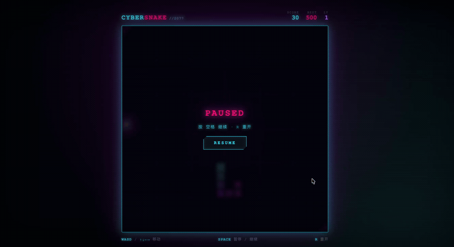

# Nautilus Agent · 生成作品演示

**StarSea Community · 作品集 · 2026-10-19**

从一句自然语言需求，到可交互的网页作品。本页收录四份独立 HTML 产物，展示专家团队与不同模型组合在小游戏、视觉设计和交互实现上的创作方向。

## 示例一览

| 示例 | 模型 / 模式 | 对话轮次 | 作品 | 打开原稿 |
| --- | --- | --- | --- | --- |
| **Max** | 专家团队(DeepSeek-V4.1-Flash + Gemini 4 Argon + Claude Fable 5.1) | **1 轮** | CYBER SNAKE // 2077 · 赛博朋克贪吃蛇 | [打开 HTML](examples/max-cyber-snake.html) |
| **Flash × Flash** | DeepSeek V4.1-Flash + Gemini 3.8 Flash | 未标注 | 简洁版贪吃蛇 | [打开 HTML](examples/flash-flash-snake.html) |
| **Flash × Argon · 1 Round** | DeepSeek V4.1-Flash + Gemini 4 Argon | **1 轮** | AETHER NEXUS · 量子星云交互终端 | [打开 HTML](examples/flash-argon-round1.html) |
| **Flash × Argon · 2 Rounds** | DeepSeek V4.1-Flash + Gemini 4 Argon | **2 轮** | NEON · 粒子形态系统 | [打开 HTML](examples/flash-argon-round2.html) |

Max 的模式、轮次与提示词由作者提供；其余模型组合与轮次按原始文件名标注。专家团队的具体成员与职责、其余示例的原始提示词和分工记录未随附件提供，因此不作补写。两份 Argon 作品分别展示不同交互场景，不据此判定为同一作品的迭代版本。

## 01 / Max：单轮生成赛博朋克贪吃蛇

**模式：Mixture  ·  专家团队 · 对话：1 轮**

原始提示词：

> 帮我生成一个酷炫的赛博朋克版本的贪吃蛇

产物为 **CYBER SNAKE // 2077**。它以青色、粉色和紫色霓虹构建视觉语言，将网格游戏场地、CRT 扫描线、暗角和呼吸光效组合为完整的赛博朋克界面。

源码包含：

- **视觉反馈**：渐变蛇身、发光食物、粒子爆裂、得分浮字、屏幕闪光与震动。
- **游戏流程**：开始、暂停、继续、重开，以及撞墙和自身碰撞判定。
- **进度与记录**：得分、等级、随进食变化的速度，以及通过浏览器本地存储保存最高分的逻辑。
- **输入方式**：方向键 / WASD、空格或 P 暂停与继续、R 重开，以及触屏滑动。

[打开 Max 原稿](examples/max-cyber-snake.html)

## 02 / Flash × Flash：简洁版贪吃蛇

**组合：DeepSeek V4.1-Flash + Gemini 3.8 Flash · 轮次：未标注**

这一份产物采用更简洁的页面结构：标题、得分、棋盘和操作提示集中在同一张游戏卡片中，适合展示从需求落地到基础交互的实现。

源码包含：

- 20 × 20 网格棋盘、蛇身与食物绘制，以及进食计分。
- 方向键 / WASD 控制，开局提示和方向输入锁定逻辑。
- 游戏结束遮罩、最终得分和重新开始按钮。
- 游戏结束后通过空格或回车快速重开。

**建议操作顺序**：展示开局提示 → 按键开始 → 连续转向 → 展示结束界面与重开。该示例未提供原始提示词，不沿用 Max 的提示词。

[打开 Flash × Flash 原稿](examples/flash-flash-snake.html)

## 03 / Flash × Argon · 1 Round：量子星云交互终端

**组合：DeepSeek V4.1-Flash + Gemini 4 Argon · 对话：1 轮（文件名标注）**

**AETHER NEXUS** 是一份以粒子力场为核心的视觉交互页面。源码将全屏 Canvas 粒子、实时 HUD 和中央玻璃质感面板放在同一个界面中，并提供多种力场与主题切换。

源码包含：

- **三种力场**：引力黑洞、斥力护盾、量子漩涡；支持按钮与数字键 1 / 2 / 3 切换。
- **超新星脉冲**：点击空白区域、点击脉冲按钮或按空格触发冲击波。
- **主题与空间感**：赛博青、合成波紫、日冕流金、矩阵翡翠四种配色，以及随指针变化的卡片倾斜效果。
- **状态显示**：粒子节点数、FPS 和指针坐标的 HUD 更新逻辑。

**建议操作顺序**：移动指针观察力场 → 切换量子漩涡 → 触发一次脉冲 → 更换主题。动态 HUD 的数值应以本机实际显示为准。
[打开 Argon 单轮原稿](examples/flash-argon-round1.html)

## 04 / Flash × Argon · 2 Rounds：粒子字形与内置自测

**组合：DeepSeek V4.1-Flash + Gemini 4 Argon · 对话：2 轮（文件名标注）**

**NEON · 粒子形态系统** 将粒子运动与文字形态切换结合起来。用户可以在 NEON、FUTURE、2026 和星尘散开之间切换，通过指针扰动字形，再观察粒子回到目标形态。

源码包含：

- **字形变换**：基于文字采样点为粒子分配目标，在聚合文字与自由漂移之间切换。
- **交互反馈**：指针排斥、点击冲击波，以及弹簧、阻尼和速度限制逻辑。
- **自测面板**：提供 RUN 按钮和收起功能，源码定义了 **30 项自测用例**，涉及字号采样、目标分配、粒子物理与全链路数值稳定性。
- **边界处理**：包含 NaN / Infinity 处理、坐标环绕和窗口尺寸变化后的重建逻辑。

******************************建议操作顺序******************************：NEON → FUTURE → 2026 → 星尘散开 → 回到 NEON → 展开自测面板并点击 RUN。自测的实际通过情况以页面运行结果为准，本文仅确认源码中存在这些用例。
[打开 Argon 双轮原稿](examples/flash-argon-round2.html)

## 如何查看

1. 保持本 Markdown、`examples/` 和 `assets/` 位于同一个文件夹中。
2. 在浏览器中打开对应 HTML，体验完整交互；Markdown 中的链接在不同预览器中可能需要选择“在外部浏览器打开”。

四份文件均为独立的 HTML / CSS / JavaScript 页面，源码未引用外部脚本或样式资源；展示 HTML 本身无需配置模型 API key。预览文件以便于链接的名称存放，内容保持原稿不变，原始文件名与校验信息见 [sources.json](sources.json)。

## 演示说明

这些作品用于展示具体生成产物，不构成统一提示词、相同预算或相同参数下的模型排名。除 Max 外，原始提示词、完整对话、耗时、token 用量及费用均未提供，本文不作性能或成本结论。

**Nautilus Agent · StarSea Community**
